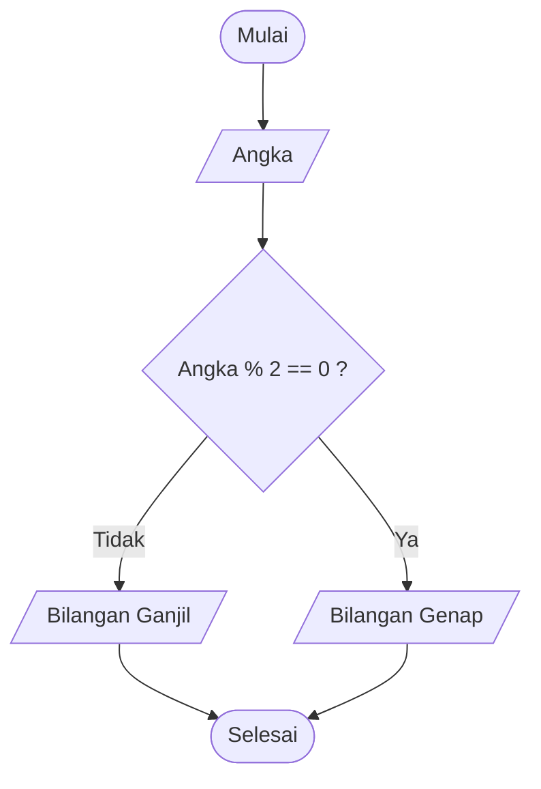
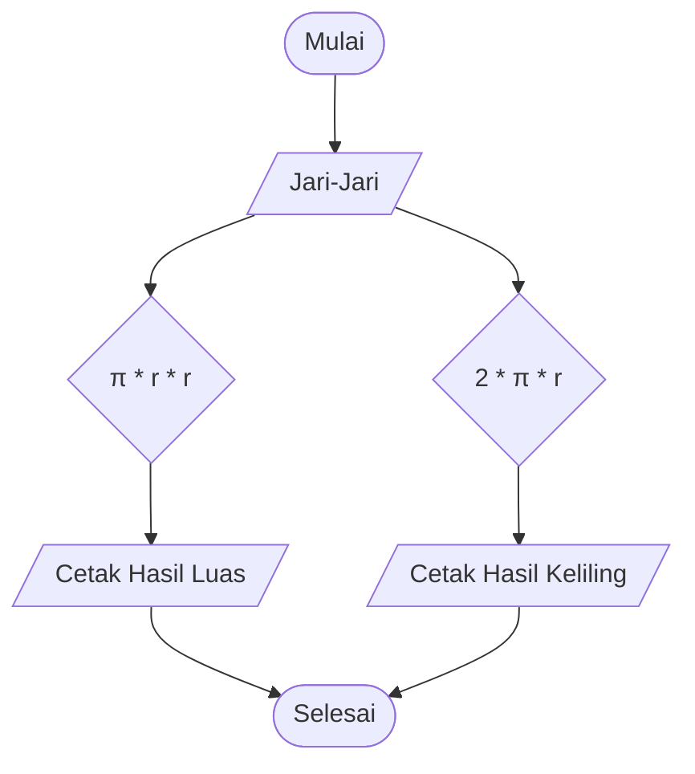

## Algoritma perpindahan kopi dan teh
1. Siapkan 2 gelas berisi teh (gelas A), kopi (gelas B)
2. Siapkan juga gelas kosong ( C ) sebagai wadah perpindahan minuman
3. Tuangkan air teh ke gelas C sampai habis
4. Tuangkan air kopi ke gelas A sampai habis
5. Lalu tuangkan kembali air teh pada gelas C ke Gelas B sampai habis 

## Algoritma menentukan bilangan ganjil atau genap
1. Mulai
2. Tentukan angka yang ingin di pilih apa itu bilangan ganjil atau genap
3. Apabila angka tersebut habis di bagi 2 atau sama dengan 0 maka bilangan tersebut genap
4. Apabila angka tersebut Menyisakan 1 saat di bagi 2 maka itu adalah bilangan ganjil
5. Selesai

## Flowchart Menentukan Ganjil Genap

## pseudo bilangan ganjil genap
DECLARE Angka : INTEGER

INPUT Angka 
IF Angka MOD 2 == 0 THEN
    OUTPUT "Bilangan genap"
ELSE OUTPUT "Bilangan ganjil"
ENDIF
## Algoritma menghitung luas dan keliling lingkaran
1. Mulai
2. Tentukan nilai untuk Jari-Jari ( r )
3. Jika rumus luas = pi * r * r
4. Maka hitung luas sama dengan 22 di bagi 7 dikali jari-jari dikali jari-jari
5. cetak hasil luas
6. Jika rumus keliling = 2 * pi * r
7. Maka hitung keliling dengan rumus keliling sama dengan 2 dikali 22 di bagi 7 dikali jari-hari
8. cetak hasil keliling 
9. selesai 

